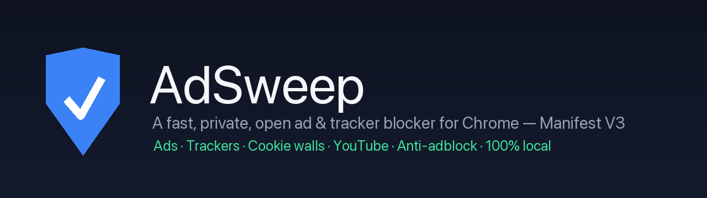

<div align="center">



# AdSweep — a fast, private, open ad & tracker blocker

**Manifest V3 · 100% local · no account · no telemetry · every release verified in real Chrome**

[](https://developer.chrome.com/docs/extensions/mv3/intro/)
[](LICENSE)
[]()
[]()
[]()

Blocks **ads, trackers, cookie banners, popups, YouTube ads and "disable your ad blocker" walls** —
using the same community filter lists as uBlock Origin, built to be clean, transparent and private.
No sign-in, no "acceptable ads" program, and the extension makes **zero network calls of its own**.

[**⬇️ Install**](#-install-60-seconds) · [Features](#-features) · [How it works](#-how-it-works) · [Build from source](#-build-from-source) · [Why trust it](#-why-you-can-trust-it)

</div>

---

## ✨ Features

| | |
|---|---|
| 🛡️ **180,000+ network rules** | EasyList, EasyPrivacy, AdGuard & uBlock Origin lists via Manifest V3 `declarativeNetRequest` |
| 🎭 **Cosmetic filtering** | 41k generic + 48k site-specific element-hiding rules, plus `:style()` / `:remove()` |
| 🧨 **Anti-adblock defuser** | A scriptlet engine (set-constant, prevent-fab/bab, abort-on-property, timer defusers…) beats "please disable your ad blocker" walls — with a **one-click "clear wall"** button |
| 🎯 **Element picker & zapper** | Click anything to hide it forever, or zap it once — stable selectors that survive reloads |
| 📜 **Network logger** | See exactly what was blocked on a tab, live, with the rule list that caught it |
| 🧩 **Custom filters** | Write your own rules — network, cosmetic or scriptlet |
| 🔗 **Subscribe to any list by URL** | Add regional/specialty lists; converted on-device and auto-updated every 3 days |
| 🧽 **Tracking-param stripping** | Removes `utm_*`, `fbclid`, `gclid` & 50+ others from links you open |
| 📊 **Per-site report & top-domains** | What's blocked here, which scripts were neutralized, your most-blocked trackers |
| ⌨️ **Keyboard shortcuts** | `Alt+Shift+P` pick · `Alt+Shift+Z` zap · `Alt+Shift+U` clear wall |
| 💾 **Import / export** | Back up every setting, filter and subscription to a file |
| 🔒 **Private by design** | No account, no analytics, no ads, no `INTERNET`-style beacons — everything stays on your device |

## ⚡ Install (60 seconds)

> AdSweep isn't on the Chrome Web Store yet — load it unpacked (works on Chrome, Edge, Brave, Opera).

```bash
git clone https://github.com/Anikesh0001/extream-ad-blocker-extension.git
```

1. Open `chrome://extensions` and turn on **Developer mode** (top-right).
2. Click **Load unpacked** → select the cloned **`extream-ad-blocker-extension`** folder.
3. Pin the icon. Done — it's already blocking. 🎉

Prefer a download? Grab the latest **[release zip](../../releases/latest)**, unzip, and Load unpacked the `adsweep` folder.

Then open the popup → **Settings → Enable everything** for maximum protection.

## 🧪 Try it

- **Score test:** visit [d3ward.github.io/toolz/adblock.html](https://d3ward.github.io/toolz/adblock.html) — you should block ~90%+. Toggle AdSweep off for the site and refresh to see the difference.
- **Anti-adblock:** hit a site with a "disable your ad blocker" wall → popup → **🧹 Clear wall**.
- **Logger:** popup → **Network log →** on any news site and watch the blocks stream in.
- **Picker:** popup → **⊕ Block element** → click any junk → it's gone for good.

## 🔧 How it works

Manifest V3 removed the old blocking `webRequest` API, so AdSweep blocks the modern way:

- **Network layer —** a build step (`tools/convert.mjs`) turns Adblock/uBlock filter syntax into
  **`declarativeNetRequest`** rules the browser enforces natively. Every emitted rule is validated
  against what Chrome's engine actually accepts, so one bad rule never voids a whole list.
- **Cosmetic layer —** a content script injects element-hiding CSS (generic + per-site), with
  `:style()` and `:remove()` support.
- **Scriptlet layer —** for anti-adblock walls, self-contained neutralizers are injected into the
  page's **MAIN world at document-start** via `webNavigation` + `chrome.scripting`.
- **Budget-aware —** Chrome only *guarantees* 30k static rules, so the service worker enables lists
  at runtime using `getAvailableStaticRuleCount()` and tells you if one can't fit. No failed installs.

```
src/            service worker, content scripts, scriptlet engine, cosmetic data
rules/          per-list declarativeNetRequest rulesets (generated)
popup/ options/ logger/ report/   the UI
tools/          build + validate + load-test + package scripts
```

## 🛠 Build from source

Requires **Node 18+** and Google Chrome.

```bash
git clone https://github.com/Anikesh0001/extream-ad-blocker-extension.git
cd extream-ad-blocker-extension

npm run build       # download filter lists → rules/ + cosmetic data
npm run validate    # check every DNR rule + manifest reference
npm run package     # assemble a clean dist/adsweep/ folder

# load dist/adsweep (or the repo root) at chrome://extensions → Load unpacked
```

Refresh the filter lists anytime with `REFRESH=1 npm run build`.

## ✅ Why you can trust it

Every release is **verified in a real Chrome** — not by hand. The harness in `tools/` loads the
extension through Chrome's DevTools protocol and asserts, automatically, that:

- all filter rulesets load and enable within budget,
- known ad/tracker hosts (DoubleClick, Google Analytics…) are **blocked**,
- normal sites (Wikipedia, GitHub) are **not** touched,
- scriptlets run in the page, the picker works, custom lists convert, and anti-adblock walls clear.

```bash
npm test            # loads the extension in Chrome and runs the checks
```

And the privacy promise is structural, not a pinky-swear: AdSweep ships **no analytics, no accounts,
and makes no network requests of its own** — the only fetches are you choosing to add a filter list.

## 🤝 Contributing

Issues and PRs are welcome — new scriptlets, site-fix filters, UI polish, or performance. See
[CONTRIBUTING.md](CONTRIBUTING.md). If AdSweep helps you, a ⭐ really does help others find it.

## 📜 License & credits

Code is licensed **GPL-3.0** (see [LICENSE](LICENSE)). AdSweep stands on the shoulders of the
communities who maintain the filter lists it uses — **EasyList, EasyPrivacy, AdGuard, uBlock Origin,
and Fanboy's lists** — each under their own licenses. Huge thanks to them.

> AdSweep is an independent project and is not affiliated with uBlock Origin, AdGuard, or AdBlock.
